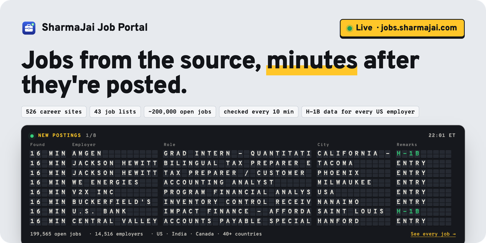
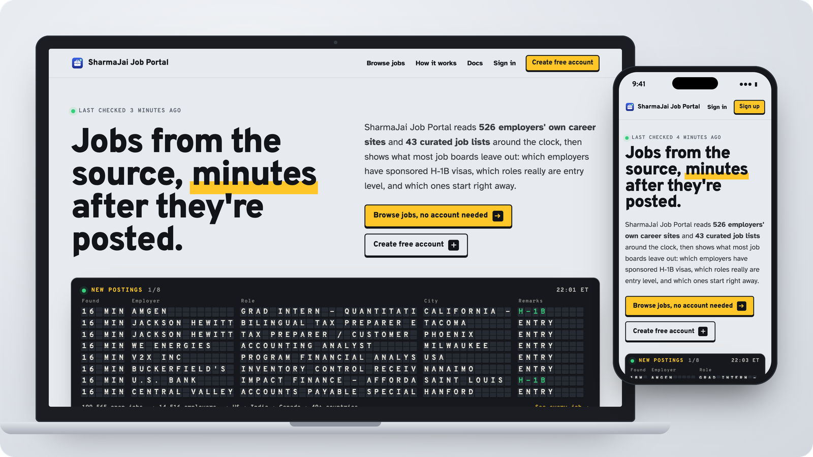
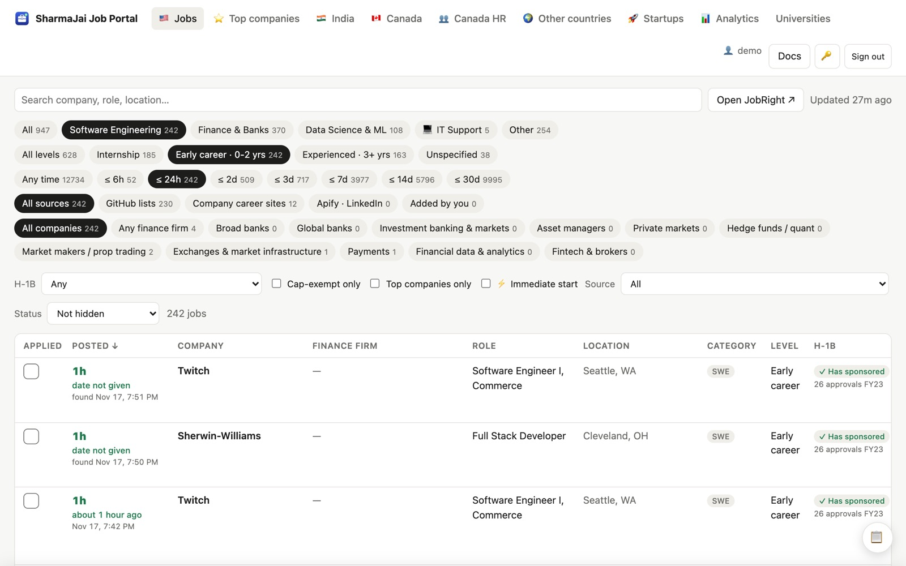
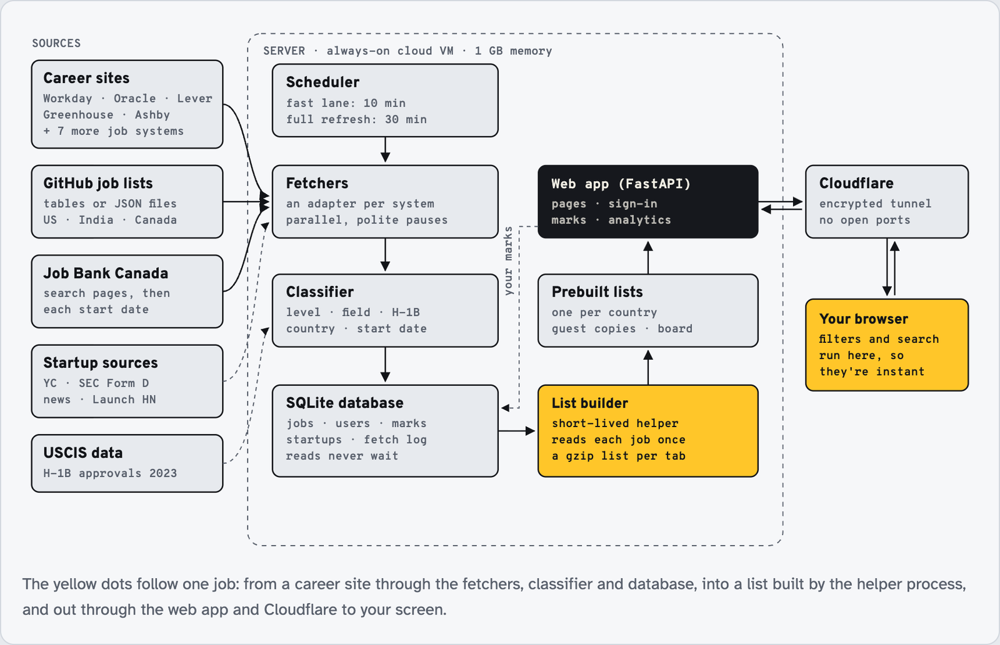

<!-- HEADER -->

 
 

**From raw data to reliable models and informed decisions.**

Building practical projects at the intersection of intelligent systems, data infrastructure, and financial analytics.

 

&nbsp;

&nbsp;

 

## About Me

Graduate student in **Applied Data Analytics at Boston University**, with a background in Computer Science and Engineering.

My interests span the full data workflow: preparing datasets, building pipelines, training models, and communicating results. I’m especially interested in applying these skills to **financial data and business decisions**.

> Clean data. Thoughtful models. Useful outcomes.

## Featured Project

### [SharmaJai Job Portal](https://jobs.sharmajai.com) &nbsp;·&nbsp; live at jobs.sharmajai.com

A free job portal I built and run for students and early-career job seekers. It reads **526 employers' own career sites** and **43 curated job lists** every 10 to 30 minutes, then shows what most job boards leave out: which employers have sponsored **H-1B visas** (USCIS data), which roles really are **entry level**, and which ones **start right away**. About **200,000 open jobs** across the US, India, Canada and 40+ countries.

  
  &nbsp;
  
  &nbsp;
  

<table>
  <tr>
    <td width="50%" valign="top">
      
       <b>The job list.</b> Filter about 150,000 US jobs down to entry-level software roles from the last day in three clicks.
    </td>
    <td width="50%" valign="top">
      
       <b>The architecture.</b> Fetchers, a rule-based classifier, SQLite and prebuilt lists served from memory.
    </td>
  </tr>
</table>

| | What I built |
| :--- | :--- |
| **Data engineering** | Adapters for 12 hiring systems (Workday, Oracle, Greenhouse, Lever, Ashby…), GitHub job lists and Job Bank Canada, deduplicated into one store and refreshed all day |
| **Classification** | Rule-based tagging of experience level (0–2 years = early career), field, H-1B history matched to USCIS legal names, and immediate-start postings |
| **Performance** | Runs on a free 1 GB cloud server: streaming list builds in short-lived processes cut peak memory from ~500 MB to ~90 MB |
| **Product** | Public browsing, email sign-up, per-user application tracking and analytics, a startup radar, and full documentation with diagrams |

Python · FastAPI · SQLite · vanilla JavaScript · Oracle Cloud · Cloudflare Tunnel

## Where I Focus

| Field | My Focus |
| :--- | :--- |
| **Machine Learning** | Predictive modeling, feature engineering, model evaluation, and computer vision |
| **Data Science** | Exploratory analysis, statistical reasoning, visualization, and clear communication |
| **Data Engineering** | SQL, PySpark, data transformation, and cloud-based processing |
| **Finance & Analytics** | Exploring financial datasets, market trends, and decision-focused analysis |

## Research & Projects

**Data Engineering · Product**

SharmaJai Job Portal: a live job portal that reads 526 employers' career sites every few minutes and adds H-1B sponsorship history for every US employer.

[Open the live site ↗](https://jobs.sharmajai.com) &nbsp;·&nbsp; [Read how it's built ↗](https://jobs.sharmajai.com/docs)

**Computer Vision · Healthcare**

Co-authored research on diabetic retinopathy diagnosis, combining deep CNN features with classical machine learning classifiers.

[Read the publication ↗](https://doi.org/10.14569/IJACSA.2025.0160827)

**Data · Models · Pipelines**

Building end-to-end projects that connect data preparation, analysis, and machine learning—with an emphasis on understandable results and reproducible workflows.

[Explore my repositories ↗](https://github.com/jai0812?tab=repositories)

**Finance · Market Data**

Exploring financial analysis through Bloomberg Terminal and Python, connecting market data with my interests in data science and engineering.

[View my portfolio ↗](https://sharmajai.com)

## Technical Toolkit

 

| Area | Tools & Technologies |
| :--- | :--- |
| **Programming** | Python, SQL, Scala, Bash |
| **ML & Computer Vision** | PyTorch, TensorFlow, Keras, scikit-learn, OpenCV |
| **Data Processing** | Pandas, NumPy, Spark, PySpark, dbt |
| **Analytics & Reporting** | Tableau, Power BI, Excel, Bloomberg Terminal |
| **Databases & Cloud** | PostgreSQL, AWS EC2 / S3 / EMR, GCP |
| **Development** | Git, GitHub Actions, Docker, Jupyter Notebook |

## Currently Exploring

- **ML:** Building and evaluating deep learning and computer vision models.
- **Data Engineering:** Processing larger datasets with PySpark and AWS.
- **Finance:** Applying Python and statistical analysis to financial data.

## GitHub Snapshot

---

**Let’s turn interesting data into something useful.**

Open to opportunities and collaborations in ML, data science, data engineering, and financial analytics.

[sharmajai.com](https://sharmajai.com) &nbsp; · &nbsp; [LinkedIn](https://www.linkedin.com/in/jaisharma08122002/) &nbsp; · &nbsp; [Projects](https://github.com/jai0812?tab=repositories)

